<picture>
  <source media="(prefers-color-scheme: dark)" srcset="dark.svg">
  <source media="(prefers-color-scheme: light)" srcset="light.svg">
  
</picture>

 

  &nbsp;
  &nbsp;
  &nbsp;
  &nbsp;
  

 

---

## 👨‍💻 About Me

I'm a **Cloud & AI Automation Engineer** based in Islamabad, Pakistan, and a student of **Artificial Intelligence at Air University**. I ship and own production systems end-to-end — from AWS/Azure infrastructure and CI/CD through to the LLM/agentic layer (LangChain, LangGraph, RAG, n8n, Zapier).

---

## 💼 Experience

### Artificial Intelligence Intern — NASTP *(Rawalpindi)*
**July 2026 – Present**
- Selected among the top 2 interns out of 3,500+ applicants for the NASTP AI internship, contributing to aerospace AI R&D
- Built a Course Recommendation RAG system using FastAPI, Qdrant, FastEmbed, and Mistral/Groq, with a React front end

### Data Engineer — Obrix Labs *(Pakistan)*
**June 2026 – Present**

### Junior DevOps / Infrastructure Engineer — SoftexSolutions *(USA, Remote)*
**March 2026 – Present**
- Designed and implemented CI/CD pipelines with GitHub Actions; managed multi-environment VPS infrastructure (Contabo, Hetzner) with automated database migration and health checks
- Implemented blue-green, zero-downtime deployment strategies; configured reverse proxies, load balancing, and SSL certificate management

### DevOps Instructor — IT TechFusion Solutions *(Remote)*
**May 2026 – Present**
Teaching DevOps fundamentals — Linux, Git/GitHub, cloud computing, YAML, GitHub Actions CI/CD, Kubernetes, AWS — including hands-on projects deploying applications to remote cloud servers.

### Data Scientist Intern — AgileForce *(United Kingdom, Remote)*
**July 2025 – Sept 2025**
- Engineered a bi-directional vector database migration utility supporting Pinecone, ChromaDB, and Qdrant — deployed at [vectormigration.com](https://vectormigration.com)
- Researched NLP and retrieval-augmented generation, building the retrieval and ingestion pipelines behind it

### DevOps Engineer — Wiz.Link Ltd *(UK, Remote)*
- Migrated infrastructure and MySQL databases across AWS EC2/RDS; built production CI/CD pipelines for Laravel and Next.js applications, cutting deployment downtime by 80%

### Artificial Intelligence Intern — iOPTIME Pvt Ltd *(Islamabad)*
**July 2024 – Aug 2024**
- Built and fine-tuned LSTM, GRU, CNN, GPT-2, and BERT models in PyTorch for text classification and generation, achieving 88% accuracy
- Implemented a Transformer architecture from scratch; fine-tuned LLMs on domain-specific datasets

---

## 🚀 Highlighted Projects

### Cleros AI — Litigation Intelligence Platform
Next.js, FastAPI, PostgreSQL, Qdrant, Docker Swarm, Traefik. Agentic legal reasoning and document intelligence platform with a multi-LLM jury-simulation engine; deployed with persistent storage, SSL/TLS, and lazy-loaded containerized embedding models. Live at [cleros.ai](https://cleros.ai).

### Vector Database Migration Tool
Automated pipeline moving embeddings, metadata, and collections between Pinecone, ChromaDB, and Qdrant via their APIs with zero-downtime data integrity. Live at [vectormigration.com](https://vectormigration.com).

### RAG-Based Personal Counsellor Chatbot (TEDx Talks)
Built with LangChain, Pinecone, and Flask; dataset scraped from TED Talk transcripts. Integrated multiple swappable LLM backends (DeepSeek, Grok, LLaMA, Mistral, Gemma 2); evaluated with TextStat and ROUGE metrics.

### GitOps CI/CD with ArgoCD & Kubernetes
Deployed a full-stack client application using GitOps principles, with ArgoCD on a Kubernetes cluster for automated, declarative deployments.

### AWS Microservice CI/CD Pipeline
End-to-end CI/CD pipeline with infrastructure-as-code (CDKTF); containerized microservices deployed to AWS ECS with automated testing gates.

### Automation Suite — Lead Gen, Feedback & Voice Agents
n8n lead-and-negotiation automation for a dealership client; a Zapier pipeline logging customer feedback to Airtable with Slack alerts; a real-time Telegram voice-transcription bot; and a Retell AI voice agent wired into an automation backend for live calls.

### Power BI Report — Programming Habits of Computing Students
Ran a 1.5-month survey across universities (748 participants) on student coding behaviors, ethics, and stress. Built an interactive Power BI dashboard backed by REST APIs for automated data updates.

### Agile Story Point Estimation via Unsupervised Learning
Clustering system (K-Means, DBSCAN, Hierarchical) to auto-assign story points from Plane and GitHub issue data.

---

## 🛠️ Core Skills

| Category | Tools & Technologies |
|----------|---------------------|
| **Languages** | Python, SQL, C++, C, JavaScript, HTML/CSS |
| **Cloud & DevOps** | AWS (EC2, ECS, ECR, RDS, S3, IAM, VPC, CloudWatch), Azure, GCP, Docker, Kubernetes, ArgoCD, GitOps, GitHub Actions, GitLab CI, Terraform, CDKTF, Ansible, Contabo/Hetzner VPS, nginx, SSL/TLS |
| **AI / Automation** | LangChain, LangGraph, RAG, Multi-Agent Systems, n8n, Zapier, REST API Integrations, Webhooks, Prompt Engineering, LLM Fine-Tuning, Model Deployment |
| **ML/DL Stack** | PyTorch, TensorFlow, Keras, Scikit-learn, Transformers, Hugging Face, OpenCV, NLTK |
| **Frameworks** | FastAPI, Flask, ReactJS, Next.js, Streamlit |
| **Databases** | MySQL, PostgreSQL, MongoDB, Redis, SQLite, Firebase, Pinecone, ChromaDB, Qdrant, Solr, ZooKeeper |
| **Monitoring & Visualization** | Grafana, Prometheus, CloudWatch, Power BI, Google Looker Studio, Matplotlib |
| **Version Control** | Git, GitHub, GitLab |
| **Other Tools** | OpenRefine, Roboflow, Excel, Linux (Ubuntu/CentOS), Bash |

---

## 📄 Publications

- [Text Generation using LSTMs and GPT-2](https://github.com/maliksaad-ahmed)
- [Decision Tree Classifier Using NumPy and Scikit-learn](https://github.com/maliksaad-ahmed)

---

## 🏆 Achievements & Leadership

  &nbsp;
  &nbsp;
  &nbsp;
  

- **Co-Lead**, Tech Team — Air University Data & AI Society (AUDAS)
- **Director Liaison** — AirTech Documentation Team
- **Documentation & Proposal Writer** — Microsoft Learn Student Ambassadors, Air University
- Conducted workshops on GitHub and MS Excel; mentored student groups on DBMS projects (Qt/C++)

**Certifications (DataCamp):** Python Data Fundamentals · Python Data Associate · Supervised Learning with scikit-learn · Power BI Fundamentals · Git & GitHub Fundamentals

---

## 🎓 Education

**Air University** — B.S. Artificial Intelligence *(Sept 2023 – Sept 2027, expected)*

---

  
   
  ⚡ Building the future at the intersection of AI and infrastructure

